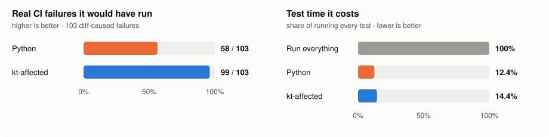

# kt-affected

**Run only the tests a change can affect, in a Kotlin / Kotlin Multiplatform Gradle build.**

kt-affected reads your build and every `.kt` file, builds a declaration-level reference graph, and
turns a diff into the exact Gradle test tasks and `--tests` filters that can observe it. It never runs
your Gradle build to do so, keeps the graph incremental, and answers in well under a second once warm.

- **Fast:** 14k-file KMP app: cold graph 2.2 s, after an edit 0.2 s, warm 0.08 s / 13 MB. Static
  discovery takes 0.06 s, where `./gradlew projects` takes 0.8–11 s.
- **Precise:** declaration-level, not module-level. A body edit to one class selects the tests that
  reach that class, through calls, supertypes, DI bindings (Metro, Dagger, Hilt, Koin) and resources.
  Formatting, comments and local renames select nothing.
- **Safe:** replayed over 586 real pull requests of a production app, it would have run 99 of the
  103 test failures those diffs caused in CI. The selector it replaced would have run 58. It costs
  14% of the full test time, against 12% ([accuracy](docs/accuracy.md)). When it cannot know, it
  fails open and says why.
- **Project-agnostic:** settings includes, `projectDir` overrides, `project(":x")` and typesafe
  `projects.x` deps, version catalogs, convention plugins, the KMP source-set hierarchy and test
  tasks. No config needed; [`kt-affected.toml`](docs/configuration.md) tunes it.

[](docs/accuracy.md)

> Status: early (0.x). Validated in depth on one large production KMP app and checked on seven
> open-source builds (okio, sqldelight, kotlinconf-app, Confetti, circuit, element-x-android, ktor).
> Feedback from other builds is very welcome.

## Install

```bash
curl -fsSL https://raw.githubusercontent.com/chrisjenx/kt-affected/main/scripts/install.sh | sh
```

or download an archive from [Releases](https://github.com/chrisjenx/kt-affected/releases) (Linux and
macOS on x86_64 and arm64, Windows x86_64), or build from source with `cargo install --locked --git
https://github.com/chrisjenx/kt-affected`.

## Quick start

```bash
cd your-gradle-build
kt-affected select --format gradle         # tasks + --tests filters for your branch vs origin's default branch
./gradlew $(kt-affected select --format gradle)
kt-affected explain                        # why each changed declaration counts, and how each test is reached
```

In GitHub Actions:

```yaml
- uses: actions/checkout@v4
  with:
    fetch-depth: 0
- uses: chrisjenx/kt-affected@v0.5.1
  id: affected
- if: steps.affected.outputs.gradle-args != ''
  run: ./gradlew ${{ steps.affected.outputs.gradle-args }}
```

More, including pre-push hooks, caching the graph and output formats: [docs/ci.md](docs/ci.md).

## Commands

```bash
kt-affected select [--base REF] [--head REF] [--format json|gradle|classes]   # the test plan
kt-affected explain [--base REF]           # per changed declaration: functional or cosmetic, and why;
                                           # per selected test: its path from a seed, edge by edge
kt-affected discover --json                # what static discovery sees: projects, deps, source sets, test tasks
kt-affected discover --gradle-export       # measure static discovery against Gradle (runs ./gradlew)
kt-affected graph                          # build or update build/kt-affected/graph.bin
kt-affected verify                         # incremental graph == cold rebuild?
kt-affected unreferenced [--base REF] [--json]   # declarations nothing references (--base: the ones a change orphaned or added)
kt-affected test-reach [--base REF] [--kover FILE] [--json]   # tests that reach no prod code; prod code no test reaches
```

`unreferenced` and `test-reach` read the same graph; see [analysis](docs/analysis.md).

`--base` defaults to the merge-base with `origin/HEAD`. Without `--head`, the plan covers the work
tree, uncommitted changes included.

## Use as a library

The same selector is a Rust library, for tools that want the plan without spawning the binary:

```toml
[dependencies]
kt-affected = { git = "https://github.com/chrisjenx/kt-affected", tag = "v0.5.1", default-features = false }
```

```rust
use kt_affected::{select, SelectOptions};

fn main() {
    let opts = SelectOptions::new().base("origin/main");
    match select(std::path::Path::new("."), &opts) {
        Ok(plan) if plan.groups.is_empty() => println!("no tests to run"),
        Ok(plan) => println!("./gradlew {}", plan.to_gradle_args().join(" ")),
        Err(e) => eprintln!("cannot tell, run everything: {e}"),
    }
}
```

`explain` returns the same plan with each verdict and test path as data. A call keeps nothing in
memory once it returns. API, errors and memory model: [docs/library.md](docs/library.md).

## Benchmarks

Measured on a production Kotlin Multiplatform app: **14,161 `.kt` files**, **193 Gradle projects**
(21 KMP), targets `android`, `iosArm64`, `iosSimulatorArm64`, `js`, `jvm`, `wasmJs`. Compared with
the Python selector kt-affected replaced there, which built an equivalent graph (edge counts within
0.03%).

| Case | kt-affected | peak | previous selector (Python) | peak | speedup |
|---|---:|---:|---:|---:|---:|
| Cold (no cache) | 2.15 s | 814 MB | 40.61 s | 1001 MB | 18.9x |
| After a body-only edit | 0.19 s | 189 MB | 10.65 s | 1138 MB | 56.1x |
| After adding a declaration | 0.29 s | 407 MB | 11.42 s | 1136 MB | 39.4x |
| Warm (nothing changed) | 0.08 s | 13 MB | 0.60 s | 238 MB | 7.5x |

Graph: 296,141 declarations, 2,812,545 edges.

### vs asking Gradle

Static discovery against Gradle answering the same question (`./gradlew projects`, and a full export of
projects, dependencies, source sets and test tasks through an init script):

| Question | daemon | configuration cache | time | peak (client) |
|---|---|---|---:|---:|
| kt-affected `discover --static` | – | – | 0.06 s | 8 MB |
| `./gradlew projects` | warm | on | 0.77 s (13x) | 114 MB |
| `./gradlew projects` | warm | off | 3.65 s (61x) | 114 MB |
| `./gradlew projects` | none | on | 2.57 s (43x) | 647 MB |
| `./gradlew projects` | none | off | 11.29 s (188x) | 1497 MB |
| Gradle export | warm | on | 0.65 s (11x) | 113 MB |
| Gradle export | none | off | 11.61 s (194x) | 1691 MB |

With a warm daemon, peak is the Gradle client only; the daemon itself had an 8 GB heap limit.

### Selection end to end

A real 7-file pull request, from a cold and a warm cache:

| Engine | cold | warm | peak (warm) |
|---|---:|---:|---:|
| kt-affected | 8.70 s | 0.97 s | 82 MB |
| previous selector (Python) | 44.01 s | 1.78 s | 235 MB |

Method: Apple M3 Max, 16 cores, 128 GB, macOS; prebuilt release binary (compile excluded); every run
a fresh process timed with `/usr/bin/time -l`; medians of 5 runs (3 for Gradle); OS file cache warm.
Public, reproducible numbers on open-source projects run in CI on every change:
[docs/benchmarks.md](docs/benchmarks.md).

### Public benchmarks

The seven open-source builds pinned in [`tests/oss/projects.tsv`](tests/oss/projects.tsv), which CI
also benchmarks and checks static discovery against. Each cell is time (peak RSS), median of 5
fresh-process runs of `bench/oss_bench.py`; "after edit" appends a comment to one main-source file.

| Project | `.kt` files | Gradle projects | declarations / edges | cold | after edit | warm |
|---|---:|---:|---:|---:|---:|---:|
| [okio](https://github.com/square/okio) | 313 | 12 | 5,425 / 66,960 | 0.21 s (38 MB) | 0.04 s (12 MB) | 0.04 s (4 MB) |
| [sqldelight](https://github.com/sqldelight/sqldelight) | 736 | 44 | 5,712 / 19,858 | 0.27 s (41 MB) | 0.16 s (12 MB) | 0.13 s (5 MB) |
| [kotlinconf-app](https://github.com/JetBrains/kotlinconf-app) | 260 | 10 | 2,027 / 6,230 | 0.08 s (27 MB) | 0.04 s (9 MB) | 0.03 s (4 MB) |
| [Confetti](https://github.com/joreilly/Confetti) | 339 | 17 | 3,251 / 10,073 | 0.11 s (33 MB) | 0.04 s (10 MB) | 0.02 s (4 MB) |
| [circuit](https://github.com/slackhq/circuit) | 535 | 46 | 5,444 / 25,261 | 0.22 s (40 MB) | 0.10 s (12 MB) | 0.05 s (5 MB) |
| [element-x-android](https://github.com/element-hq/element-x-android) | 4,384 | 359 | 32,968 / 171,886 | 0.92 s (136 MB) | 0.39 s (34 MB) | 0.25 s (8 MB) |
| [ktor](https://github.com/ktorio/ktor) | 2,445 | 138 | 28,801 / 238,846 | 0.96 s (112 MB) | 0.21 s (28 MB) | 0.16 s (7 MB) |

Gradle projects counts the root and the parent projects Gradle creates for nested paths. Measured
2026-11-05 with kt-affected 0.3.1 from `main` on an Apple M3 Max, 16 cores, 128 GB, macOS, under
heavy unrelated load (load average about 53): read these as upper bounds; the CI job compares like
for like on one runner.

## Documentation

- [How it works](docs/how-it-works.md): discovery, the graph, incremental updates, selection, the cosmetic classifier
- [Configuration](docs/configuration.md): `kt-affected.toml`
- [Analysis](docs/analysis.md): `unreferenced` and `test-reach`, and their JSON schema
- [CI and pre-push](docs/ci.md)
- [Library](docs/library.md): the Rust API
- [Accuracy](docs/accuracy.md): how it was validated, and what is not yet measured
- [Public replay](docs/replay.md): the same check on public repositories, rerunnable by anyone
- [Benchmarks](docs/benchmarks.md)

## Credits

Built on [kt-syntax](https://github.com/Hexay/ktrs) from ktrs, a lossless Kotlin parser in Rust.

## License

Licensed under either of [Apache License, Version 2.0](LICENSE-APACHE) or [MIT license](LICENSE-MIT)
at your option.
