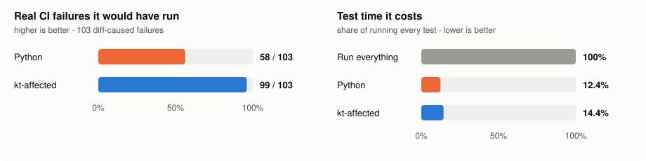

# Accuracy

**kt-affected would have run 99 of the 103 real test failures that a production app's last 586 pull
requests caused in CI. The selector it replaced would have run 58.** It costs a little more test
time to get there: 14.4% of running every test, against 12.4%.

## Scorecard

Replay of every merged pull request (586) of a production Kotlin Multiplatform app (14k `.kt` files,
193 Gradle projects), against the selector kt-affected replaced there (a Python script working at the
same declaration level) and against what actually failed in CI.

| | previous selector | **kt-affected** |
|---|---:|---:|
| Real CI failures it would have run (out of 103 the diffs caused) | 58 (56%) | **99 (96%)** |
| Real CI failures missed | 45 | **4** |
| Test time, share of running every test | **12.4%** | 14.4% |
| Median test time per pull request | **9.3 min** | 10.2 min |
| Total test time over the 586 PRs (running everything: 1,541 h) | **191 h** | 222 h |

So for about 3 extra minutes of test time per pull request (summed across tasks, not wall clock),
kt-affected misses 4 real failures where the previous selector missed 45.

## Where the difference comes from

**Failures only kt-affected catches (41):**

| Why the previous selector missed them | Failures |
|---|---:|
| A shared test source set (`commonTest`, a custom UI-test set) runs under every target's test task; the old selector ran it under `jvmTest` only, and the failure was in the wasm run | 30 |
| A test reflects over `X::class`, or reaches the change through a call it cannot type | 5 |
| A build-logic change to test-JVM settings, or a compiler-plugin version bump, affects every test in the task | 6 |

**The 4 kt-affected misses** are one pull request's integration tests, which that project's config
deliberately runs only when the integration module itself changes (`[modules] direct_only`).

**Where the extra test time goes.** Mostly the same multi-target mapping that catches those 30
failures: shared tests also run under the js, wasm, iOS and Android test tasks. If your CI does not
run some of those per pull request, mark the ones a quick loop runs with `[tasks] local` so a runner
defers the rest, or exclude tasks you never want selected with `[tasks] only` (see
[configuration](configuration.md)); either way the cost goes with them. The rest is DI dispatch through
widely used interfaces, which is sound but conservative.

## Is skipping safe?

kt-affected also skips tests the previous selector ran: 33,043 class runs on 357 of the 586 pull
requests. Each skip was checked three ways:

- **Real failures:** no failure the previous selector caught is lost (all 58 are in kt-affected's 99).
- **Oracles:** a name oracle flags any skipped test that names a changed declaration; every flagged
  case that was hand-checked was a false positive (test-local names, comments, `@Suppress`-only edits).
- **Running them:** samples of the skipped tests, for every narrowing rule, were run at each pull
  request's merge commit. All passed.

That is strong evidence, not proof: only a sample of the skipped tests was executed.

## How it improved

| Run | Real failures run | Test time |
|---|---:|---:|
| Previous selector | 58 / 103 | 12.4% |
| kt-affected 0.1.0 | 91 / 103 | 13.8% |
| + test-filter, `init`-block and DI-graph fixes | 91 / 103 | 13.4% |
| + build-logic and untyped-receiver recall fixes | 99 / 103 | 15.1% |
| 0.3.1, the app's final config (current) | 99 / 103 | 14.4% |

The last row's saving is configuration, not selection: the earlier runs still listed the old selector's own scripts as "selector changed" triggers, so 11 pull requests that edited them ran everything.

Two failures first counted as diff-caused were hand-checked as flakes and excluded from every row. Every case behind these fixes is pinned in the public edge-case corpus (`tests/cases/`).

## Method notes

- Real failures come from the CI runs of each pull request. A failure counts only if the diff caused
  it: a changed test, or a test that reaches a changed declaration. Flakes, time bombs and
  environment failures were excluded, and every row either selector missed was hand-checked.
- "Would have run" is strict: the right module and the right Gradle test task.
- Test time is the sum of per-class durations from a full CI run, so it measures test CPU, not wall
  clock.

## Graph parity

On the same app (296k declarations), kt-affected's graph and the previous selector's agreed on
99.76% of 6.0M edges. Every remaining difference class was explained and covered by a test, and most
were bugs in the previous selector.

## Discovery

On the same app, static discovery found 5,004 of the 5,126 project dependencies Gradle reports (the
rest come from a root `kover` aggregation, which it warns about), no extra ones, and every test task
that has test sources. Static discovery of pinned okio and sqldelight checkouts is checked in CI
against reviewed goldens (`tests/oss/`).

## Public replay

The numbers above come from an app that cannot be named. [replay.md](replay.md) asks the same
question of public repositories, using only their CI history, and anyone with `gh` can rerun it.
Run 2026-11-06, over every pull request merged in 90 days:

| Repository | PRs | Diff-caused failures | kt-affected ran | Module-level ran | kt-affected share of test classes | Module-level share |
|---|---:|---:|---:|---:|---:|---:|
| element-x-android | 501 | 52 | 47 (90%) | 51 (98%) | 19.9% | 63.3% |
| circuit | 109 | 45 | 45 (100%) | 45 (100%) | 33.2% | 76.9% |

Module-level is what affected-module Gradle plugins do: run every test task of each changed module
and its dependents. kt-affected selects about a quarter to a half of what module-level does.

Every failure a changed declaration reached through code was run. The first run missed 14 rows;
fixes for source-scanning (Konsist) tests and Android release-variant unit tests caught 9 of them.
The 5 left are 4 tests in a private submodule and 1 catalog bump of a runtime library, whose fix
cost too much test time and was reverted. Details in [replay.md](replay.md).

